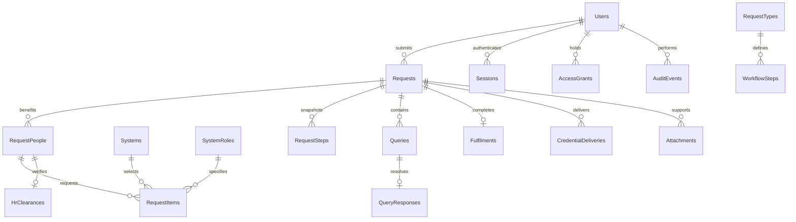

# Data model and frontend coverage

The schema normalizes identities, requested access, routing and history. Form-specific supplementary fields are retained as bounded, valid SQL JSON, so the numerous existing form components can evolve without adding hundreds of nullable columns to Requests.

## Data mapping

| Current frontend area/data | SQL Server source |
| --- | --- |
| `mockUsers`, local directory, role assignments and profile | Users, PortalRoles, Lookups |
| Branches, departments, designations | Lookups with a constrained Kind |
| System selector and supported roles | Systems, SystemRoles |
| My access / user current access | AccessGrants, linked to approved source Requests |
| New ID and on-behalf forms | Requests, RequestPeople, RequestItems; Details holds `newUserDetails` |
| Self access / ID upgrade / reset | Same core tables; `transferDetails`, `upgradeDetails`, `resetDetails` in Details |
| Batch access and multi-employee forms | RequestPeople + RequestItems; supplementary `batchDetails` |
| Branch transfer | Snapshotted steps plus `transferDetails` |
| Branch/department movement and employee review | Source/destination IDs, SubjectUserId, employee-review status, RequestRevisions and normalized access |
| Email creation | Requested system items and `emailCreationDetails` |
| External-device email | Requested system items and `externalDeviceDetails` |
| Employee/system deactivation | Revoke items, account/grant changes on verified fulfilment, `deactivationDetails` |
| Auto-forward / mailing-group forms | `autoForwardDetails`, `mailingGroupDetails` retained in ticket Details; actual external changes are verified by IT |
| IDrive and N Drive | Seeded request types and requested system items |
| Mailing-group directory/member lists | MailingGroups, MailingGroupMembers |
| Consent, drawing/signature and submitted-form preview | Users.Signature, Requests.SignatureSnapshot, ConsentAt, RequesterSnapshot and Details.submittedForm |
| Approval workflow and recommendation remarks | WorkflowSteps templates; RequestSteps per-ticket snapshots |
| Timed acting authority and effective roles | RoleDelegations; uidms_EffectiveRoles, uidms_ManagedScopes and uidms_StepReviewers |
| Department heads and branch managers by system ID | OrganizationApprovers.ScopeId references Lookups; UserId references Users; RequestSteps.AssignedUserId pins the exact approver |
| HR police/reference clearance and previous changes | HrClearances plus transactional AuditEvents |
| Query inbox, response threads, floating bubble | Queries and QueryResponses |
| IT/HO processing and closure | Requests.Status and Fulfilments |
| Temporary password/username delivery | CredentialDeliveries, AES-GCM ciphertext and recipient, expiry, read-once state |
| Dashboard counters | Scoped SQL aggregates over live tickets, current steps and queries |
| Notifications and optional SMTP | Notifications, EmailOutbox |
| Request editing and removal | RequestRevisions, soft deletion/cancellation, append-only AuditEvents |
| Audit trail, actor, source IP and event correlation | AuditEvents |
| Real authentication instead of mock account selection | Users password/MFA fields, AuthChallenges, Sessions and shared RateLimitBuckets |
| Supporting documents | Quarantined Attachments with hashes and scanner decision |

The seed generator reads the existing frontend's catalogue, department and designation constants, then produces a **standalone SQL file**. The deployed backend does not import or depend on the frontend. It does not copy mock employees or passwords into SQL Server.

## Relationships

## Authority and state rules

- `requesterId`, roles, source IP, timestamps, ticket number, status, routing and steps come from the backend. They cannot be assigned in a create body.
- `My requests` means submissions by the authenticated actor. Being a beneficiary, reviewer or query recipient does not put another user's ticket there.
- Manager steps resolve to OrganizationApprovers for the ticket's target branch or department, following existing head-office/Gulshan routing. AssignedUserId identifies the permanent account, with no change to its base portal role or profile location. Timed RoleDelegations replace recommendation authority during leave; scoped visibility and exact eligible reviewers are computed in SQL. Each branch has one manager and each department one head; an employee may head multiple departments. Legacy unassigned steps retain role/scope authorization; a unique active legacy manager is used only when no explicit mapping exists. Inactive, missing or ambiguous resolution blocks submission. IT, HR, CITO, COO and administrators have operational visibility according to their current effective roles. Portal administrators do not gain an implicit business-approval override; configuration authority and approval authority are separated.
- A requester or movement subject cannot approve their own request. Provide alternate authorized reviewers when the usual manager is also the requester.
- Initial service defaults use Manager → optional HR → IT → CITO → COO. A recently authenticated Super Admin can configure any unique subset/order of these roles, with organization routing retained for Manager. Individual approvals do not mark the whole ticket approved until the saved remaining chain is complete.
- Self-service reset/unlock initially uses User → CITO → Processing → Completed, with no required justification. Its saved workflow is configurable like other services. The frontend renders actual RequestSteps, including pending rows, rather than a fixed frontend chain.
- A movement starts with employee access review, then the normal destination approval route. Only systems marked TransferManaged may be selected in the employee review.
- Workflow studio can apply edits to pending steps of ongoing requests. Completed decisions retain their original role, scope, actor, timestamp, remark and position; processing/completed tickets are not reopened. All affected requests receive a new rowversion and an audit event.
- Query routing is validated by the server; a single open query pauses a ticket. Only its intended recipient may respond, once. The prior review status is restored.
- HR completion rules are enforced before HR approves new-user requests.
- IT processing/fulfilment requires completed approvals. Manual external provisioning is not replaced by an API status change.
- New-user credential custody uses the recorded approving manager/head, or the explicit scope assignment (then a unique active legacy scoped manager/head) when manager approval is omitted. The custodian can view their delivery and its request. Other requests use the movement subject or submitter. Credentials are not sent in notification emails or general ticket JSON.
- All state-changing business operations write an audit record in the same transaction. Failed writes roll back the business change.
- SQL rowversion protects stale concurrent actions. The API returns 409 instead of silently overwriting a newer record. Deadlock victims fail safely; clients should reload and retry deliberately.
- Removal preserves history through cancellation and DeletedAt. There is no HTTP hard-delete endpoint for audit records or submitted requests.

## SQL design choices

GUIDs identify records; a database sequence produces human-readable ticket numbers and prevents collisions across API instances. Sequence gaps after rollback are expected. Dates use UTC `datetime2(3)`; the frontend formats display in Asia/Dhaka.

Foreign keys enforce parent relationships. Unique indexes protect employee IDs, email addresses, system roles, active grants and open-query uniqueness. JSON columns have `ISJSON` checks. API checks additionally enforce cross-table rules such as a selected role belonging to its system and a selected lookup having the correct kind.

Runtime secrets are outside SQL. Passwords use salted scrypt hashes. Session, activation and challenge tokens are stored as SHA-256 digests of high-entropy random values. MFA and delivery data use authenticated encryption with context binding. Drawn signatures and consent records are evidence of acknowledgement, **not qualified digital signatures or a non-repudiation service**.

Append-only audit restrictions protect against the runtime account changing history. A SQL Server DBA can still bypass application controls; use SQL Server auditing, restricted DBA privileges and an external immutable log/archive if required by your policy.

## Scope of external provisioning

This backend manages the portal's workflow, records and access inventory. Actual ICBS/AD/email/file-server account creation, password resets, external forwarding and mailbox/group configuration require your approved provisioning systems or IT procedures. MailingGroupMembers is a portal directory record; changing it does not independently change Exchange/AD. Do not claim provisioning succeeded merely because an HTTP call succeeded.

JSON Details does not replace business validation. Critical beneficiary, scope, selected access, operation and workflow fields are normalized and enforced. Supplementary form fields should receive any additional bank-specific validation before integration, especially device policy, external forwarding restrictions, naming conventions and HR evidence requirements.
